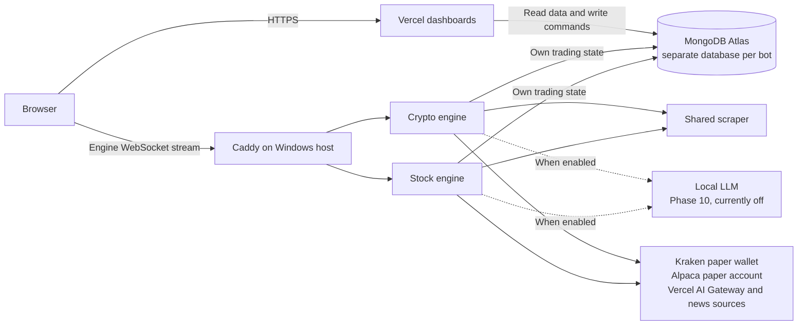

# Marketbots

Two autonomous, AI-driven paper-trading bots in one pnpm monorepo:

- **CryptoMarketBot** trades Kraken spot pairs 24/7 in a Kraken CLI paper wallet. Dashboard: [cryptomarketbot.app](https://cryptomarketbot.app).
- **StockMarketBot** trades US stocks and defined-risk options on market days in an Alpaca paper account. Dashboard: [stockmarketbot.app](https://stockmarketbot.app).

In both, Grok (through the Vercel AI Gateway) researches and decides, and deterministic code sizes and checks every order. Each bot has its own always-on engine, its own Next.js dashboard on Vercel with its own owner sign-in, and its own database on MongoDB Atlas. One Docker stack, `marketbots`, runs both engines and a shared headless scraper on the owner's Windows server.

**Paper trading only.** Neither engine has a live-trading code path.

## Architecture

### Runtime topology



## Layout

```
apps/crypto-engine/     crypto engine (Docker)
apps/crypto-web/        crypto dashboard (Vercel)
apps/stock-engine/      stock engine (Docker)
apps/stock-web/         stock dashboard (Vercel)
apps/scraper/           headless Chromium sidecar shared by both engines (own npm lockfile)
packages/config/        tsconfig base, ESLint presets with the import boundaries, Vitest presets
packages/crypto-core/   crypto schemas and types
packages/stock-core/    stock schemas and types
contracts/              behavior snapshots per bot
docs/                   architecture, per-bot design, server runbook, plans
compose.yml             the marketbots stack: both engines, the scraper, the local LLM (off)
crypto.env.example      every crypto variable, by where it's used (copy to crypto.env)
stock.env.example       every stock variable, by where it's used (copy to stock.env)
```

The shared packages (`core`, `engine-kit`, `wire`, `ui`, `web-kit`) were added in Phases 5–8 of the [merge plan](docs/plans/MARKETBOTS_PLAN.md).

## Development

Node 22.12+ and pnpm 10. Copy `crypto.env.example` to `crypto.env` and `stock.env.example` to `stock.env` at the repo root, and put local overrides (a `_dev` database, no Discord, fake Alpaca keys) in `crypto.local.env` / `stock.local.env`. See [docs/SERVER.md §3](docs/SERVER.md#3-the-env-files).

```bash
pnpm install
pnpm typecheck && pnpm test && pnpm lint && pnpm build   # the gate before every deploy

pnpm dev:crypto-engine    # crypto engine (tsx watch); needs the Kraken CLI on PATH
pnpm dev:crypto-web       # crypto dashboard (next dev)
pnpm dev:stock-engine     # stock engine (tsx watch)
pnpm dev:stock-web        # stock dashboard (next dev)

# crypto backtest from the command line (public Kraken data, no database)
pnpm backtest -- --symbols BTC/USD,ETH/USD,SOL/USD --strategies trend,momentum --interval 240
```

`build`, `test`, `typecheck` and `lint` run in every workspace package (`pnpm -r`). The dev scripts read `<bot>.env`, then `<bot>.local.env`. The scraper sits outside the pnpm workspace (own npm lockfile) and is built only as its Docker image.

## Docs

- [docs/ARCHITECTURE.md](docs/ARCHITECTURE.md): the platform: topology, layout, what is shared and what stays per bot.
- [docs/CRYPTO.md](docs/CRYPTO.md), [docs/STOCK.md](docs/STOCK.md): each bot's design.
- [docs/SERVER.md](docs/SERVER.md): the server, the Docker stack, env files, deploys, Vercel, troubleshooting.
- [AGENTS.md](AGENTS.md): conventions for changing this repo (package boundaries, shared code, safety rules).
- [docs/plans/MARKETBOTS_PLAN.md](docs/plans/MARKETBOTS_PLAN.md): the merge plan and its progress; [docs/plans/MASTER_PLAN.md](docs/plans/MASTER_PLAN.md): the news engine plan.

Paper trading with simulated money for research. Not financial advice; nothing here guarantees profits, and options can lose their entire value.
