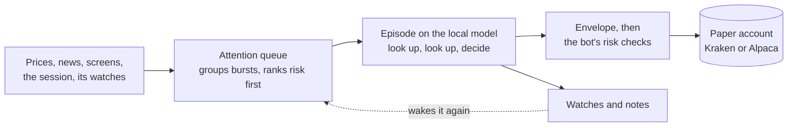
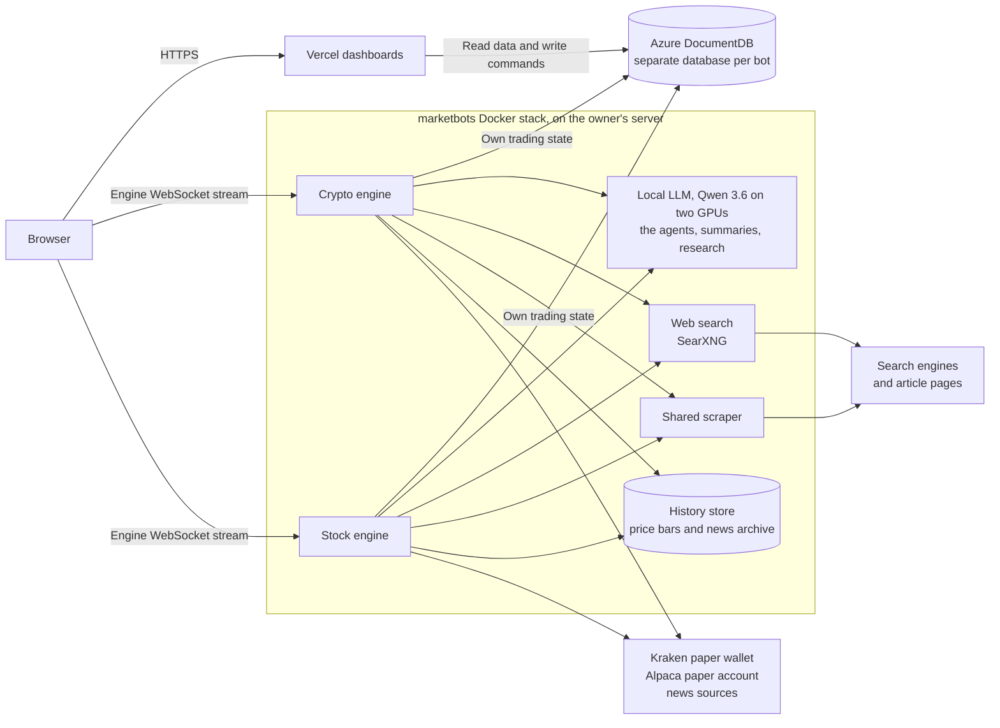

# Marketbots

Two autonomous, AI-driven paper-trading bots in one pnpm monorepo:

- **CryptoMarketBot** trades Kraken spot pairs 24/7 in a Kraken CLI paper wallet. Dashboard: [cryptomarketbot.app](https://cryptomarketbot.app).
- **StockMarketBot** trades US stocks and defined-risk options on market days in an Alpaca paper account. Dashboard: [stockmarketbot.app](https://stockmarketbot.app).

Both run on a local model (Qwen 3.6 35B-A3B, on the server's two GPUs), and in both, deterministic code sizes and checks every order. Each bot has its own always-on engine, its own Next.js dashboard on Vercel with its own owner sign-in, and its own database on Azure DocumentDB (MongoDB). One Docker stack, `marketbots`, runs on the owner's Windows server: both engines, the local model server, a web search service (SearXNG), a shared headless scraper and the history store (Postgres with TimescaleDB: price bars and the news archive).

**Paper trading only.** Neither engine has a live-trading code path.

## How the bots decide

In both bots **the agent** trades the paper account (agent level `auto`, set in Admin). Code watches prices, the news, the screens, the market session and the agent's own watches all the time, and wakes it when something matters. In each wake-up (an *episode*) it looks things up one step at a time (quotes, technicals, the order book, news, years of history, its past decisions), then decides. Its decisions go through its own limits (the envelope) and the bot's risk checks, which approve, resize or reject each order before it reaches the paper account. Circuit breakers drop it back to **shadow**, where its decisions fill only a simulated account, the **shadow book**, until the owner promotes it again. Each dashboard's Research → Agent page shows it at work.

The **scheduled cycles** that traded before it (on a timer, the model read what the news engine found, searched the web through our own search service where it left gaps, and wrote one structured decision) stop at level `auto`. The owner's one-time seed buy, and stock's weekly core-book review, still run that way.



The plan behind the agent, and how it earns more authority, is [docs/plans/LOCAL-AI.md](docs/plans/LOCAL-AI.md).

## Architecture

### Runtime topology



## Layout

```
apps/crypto-engine/     crypto engine (Docker)
apps/crypto-web/        crypto dashboard (Vercel)
apps/stock-engine/      stock engine (Docker)
apps/stock-web/         stock dashboard (Vercel)
apps/scraper/           headless Chromium sidecar shared by both engines (own npm lockfile)
packages/config/        tsconfig base, ESLint presets with the import boundaries, Vitest presets
packages/core/          pure shared schemas and helpers, no I/O
packages/engine-kit/    engine runtime shared by both engines
packages/wire/          the news engine, shared by both engines
packages/history/       the history store client (Postgres): bars and news archive, shared by both engines
packages/agent/         the agent runtime: attention queue, episodes, tools, watches, envelope, shadow book
packages/ui/            client-safe React shared by both dashboards
packages/web-kit/       server-only dashboard helpers
packages/crypto-core/   crypto schemas and types
packages/stock-core/    stock schemas and types
contracts/              behavior snapshots per bot
docs/                   architecture, per-bot design, server runbook
compose.yml             the marketbots stack: both engines, the local LLM, search, the scraper, the history store
.env.example            every variable of the stack, in sections by who reads it (copy to .env)
```

## Development

Node 22.12+ and pnpm 10. Copy `.env.example` to `.env` at the repo root, and put local overrides (a `_dev` database, no Discord, fake Alpaca keys) in `.env.local`. See [docs/SERVER.md §3](docs/SERVER.md#3-the-env-file).

```bash
pnpm install
pnpm typecheck && pnpm test && pnpm lint && pnpm build   # the gate before every deploy

pnpm dev:crypto-engine    # crypto engine (tsx watch); needs the Kraken CLI on PATH
pnpm dev:crypto-web       # crypto dashboard (next dev)
pnpm dev:stock-engine     # stock engine (tsx watch)
pnpm dev:stock-web        # stock dashboard (next dev)

# crypto backtest from the command line (public Kraken data, no database)
pnpm backtest -- --symbols BTC/USD,ETH/USD,SOL/USD --strategies trend,momentum --interval 240
```

`build`, `test`, `typecheck` and `lint` run in every workspace package (`pnpm -r`). The dev scripts read `.env`, then `.env.local`, through `mb-env` (`@mb/config`), which hands each process its bot's variables without the `CRYPTO_` / `STOCK_` prefix. The scraper sits outside the pnpm workspace (own npm lockfile) and is built only as its Docker image.

## Docs

- [docs/ARCHITECTURE.md](docs/ARCHITECTURE.md): the platform: topology, layout, what is shared and what stays per bot.
- [docs/CRYPTO.md](docs/CRYPTO.md), [docs/STOCK.md](docs/STOCK.md): each bot's design.
- [docs/SERVER.md](docs/SERVER.md): the server, the Docker stack, the env file, deploys, Vercel, troubleshooting.
- [docs/plans/LOCAL-AI.md](docs/plans/LOCAL-AI.md): the local model, the history store and the agent: the plan, the measurements behind it, and what was built.
- [AGENTS.md](AGENTS.md): conventions for changing this repo (package boundaries, shared code, safety rules).

Paper trading with simulated money for research. Not financial advice; nothing here guarantees profits, and options can lose their entire value.
